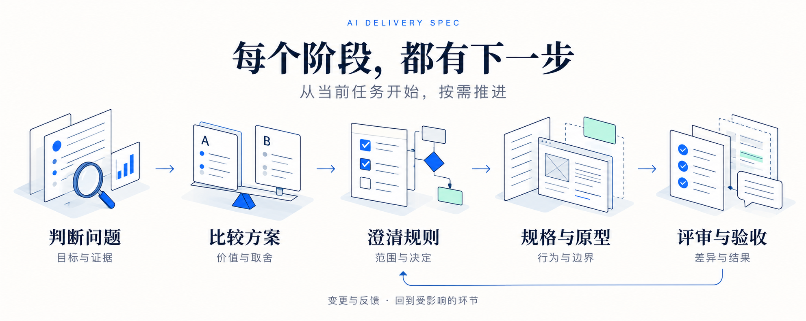

<a id="top"></a>

# AI Delivery Spec

**做值得做的产品，让团队和 AI 少猜、少返工。**

AI Delivery Spec 帮你判断需求价值、挖透业务细节，形成产品能确认、开发能实现、测试能验收的需求与原型，让团队和 AI Coding Agent 据此协作。

[](https://clawhub.ai/franklinxkk/skills/ai-delivery-spec)
[](https://skillhub.cn/skills/user_12c92261/ai-delivery-spec)
[](LICENSE)

<sub>ClawHub 累计下载：2026-10-30 核实。SkillHub 对 5.5.5 的历史评测：4.6/5，评级「优秀」。</sub>

**[能帮我做什么](#scenarios) · [开始试用 →](#install) · [看交付示例](#examples) · [English](#en)**

<a id="scenarios"></a>

## 从你正在做的事开始

只有一句想法、需求已经确定，或是修改现有产品，都可以直接开始。

| 你的任务 | 它怎样帮你 | 可以得到什么 |
|---|---|---|
| 判断需求值不值得做 | 核对真实问题，比较方案与投入 | 判断依据、方案取舍、待验证问题 |
| 把模糊需求挖清楚 | 沿用已知信息，追问关键分歧，补齐场景与边界 | 清楚的范围、业务规则和未决项 |
| 让团队和 AI 准备开工 | 按团队模板写清功能，用可操作原型确认交互 | 按模块组织的 PRD、原型与验收条件 |
| 修改已有系统 | 核对影响范围，保留有效细节，同步修订 | 更新后的文档、原型及需回归的路径 |
| 评审或核对交付 | 从开发和测试视角冷读，验证主路径与关键反例 | 具体差异、验证结果和剩余问题 |

<a id="install"></a>
<a id="zh"></a>

## 一分钟开始

**安装到支持 Agent Skills 的工具：**

```bash
npx skills add franklinxkk/ai-delivery-spec
```

按提示选择你的 Agent。也可以[下载干净安装包](https://github.com/franklinxkk/ai-delivery-spec/releases/latest)，通过宿主的技能导入功能安装。[查看其他安装方式](references/tool-adapters.md)

**然后，把真实问题交给它：**

```text
使用 ai-delivery-spec：客户说审批太慢，想加一个自动审批功能。
结合现有流程，先帮我判断真正的问题和可选方案，再带我把需求做清楚。
```

已有 PRD、原型、团队模板或客户反馈，就一起提供。明确的小改直接处理，复杂需求再逐步澄清。**日常使用不需要学模板、写 YAML 或运行 Python。**

<a id="shortcuts"></a>

熟悉后可用四个意图简写：`/dig` 判断与深挖需求，`/prd` 编写需求文档，`/proto` 制作原型，`/ads` 处理当前需求任务。宿主不识别裸斜杠命令时，直接说“使用 ai-delivery-spec……”即可。

<a id="capabilities"></a>

## 它怎样帮你把需求做清楚



### 判断价值：找准要解决的问题

客户说“加个自动审批”，先弄清审批慢在哪里、影响谁、是否值得投入。依据不足时，可以先验证、缩小范围或暂缓，帮助产品把精力用在真正需要解决的问题上。

### 选择方案：把取舍摆清楚

结合现有系统和约束比较做法，讲清预期收益、代价与风险，帮助团队形成有依据的选择。关键决定由人掌握；已确认的信息继续沿用，真正影响方案的分歧才需要追问。

### 明确需求：让接手的人知道怎么做

把字段、计算、权限、动作、状态、异常和验收集中在各自模块。研发和 AI Coding Agent 能顺着用户任务理解业务，测试能据此编写用例；设计与业务人员可以操作原型确认交互，在页面或弹窗旁查看对应说明。[了解评审方式](references/review-workspace.md)

例如，一次“提交”要讲清何时算成功、失败后保留哪些输入、结果未知时怎样确认，减少开工后反复追问规则。

### 验证结果：用实际表现核对原来的决定

以原始目标和已确认规则为依据，核对成功、失败、无权限和重复提交等关键情况。文档与原型相互一致，还要检查它们是否一起理解错了；收到反馈后，修订受影响的需求与原型，并验证结果。能实际验证的就执行，未验证的如实说明。

<a id="examples"></a>
<a id="roles"></a>

## 看看团队能拿到什么

| 交付示例 | 接手的人可以看到什么 |
|---|---|
| [一项筛选改动](examples/minimal-v5/requirement-card.md) | 产品和业务用一份简短需求卡确认规则与验收 |
| [工单模块 PRD](examples/medium-review-handoff/requirement.md) | 研发、测试按模块连续阅读角色、动作、状态与异常 |
| [可操作评审原型](examples/medium-review-handoff/review-prototype.html) | 下载示例目录后操作模拟业务，设计和评审人员就近查看功能说明 |
| [配置如何产生真实行为](examples/configuration-to-consumption.md) | 研发与 AI Coding Agent 从配置保存核对到实际执行、结果与反例 |

<a id="customization"></a>

## 用你们自己的模板和设计规范

提供团队现有 PRD 模板、组件规范或参考原型，说一句“本项目沿用这些资料”，就按你们已有的文档和交互习惯工作。需要以后复用时，由 Agent 在团队或项目目录记录引用；原件保存在 Skill 安装目录之外，升级后继续读取。[查看团队定制](references/team-customization.md)

内置交通、CRM、教育、OA、医疗、数据产品、AI 原生、媒体与知识管理资料，支持中文摘要、术语与别名检索；也可接入私有领域资料。[打开领域导览](references/domains/中文导览.md)

<a id="faq"></a>

<details>
<summary><strong>常见问题与进阶入口</strong></summary>

- **一句话需求能用吗？** 能。先判断问题与关键未知，不要求先写 PRD。
- **已有文档需要重写吗？** 保留骨架和有效细节，按本次目标修订。
- **每次都要做原型、跑检查吗？** 按任务选择交付和验证，小改保持轻量。
- **怎样与 Coding Agent 配合？** 本 Skill 提供明确的业务规则、验收条件和变更依据；工程方案、编码、部署与生产验收由对应团队和工具承接。
- **检查 PASS 就能直接上线吗？** PASS 对应具体检查范围，真实系统联调与业务验收仍要实际执行。
- **遇到安装或检查问题？** 看[避坑与排错](references/troubleshooting.md)。
- **需要自动化工具或机器交接？** 看[工具与阶段](references/stages.md)、[上下文与交接](references/context.md)。
- **想了解版本改动？** 看 [CHANGELOG](CHANGELOG.md)。

</details>

<a id="en"></a>

<details>
<summary><strong>English — get started</strong></summary>

**Build what matters, with less guesswork and rework for your team and AI.**

AI Delivery Spec helps you assess whether a need is worth pursuing, explore the business details, and turn decisions into requirements and interactive prototypes. Product teams can confirm the intent, developers and Coding Agents can implement the behavior, and testers can derive acceptance cases.

Start with an idea, confirmed requirements, an existing system or review feedback. Compare options, clarify questions that affect the decision, and check results against the original intent. People retain the key decisions, and small changes stay small.

Install with `npx skills add franklinxkk/ai-delivery-spec`, then try:

```text
Use ai-delivery-spec: customers say approvals are slow and want automatic approval.
Review the current workflow, compare solutions, and help me clarify the requirements.
```

For confirmed work, ask it to update your team's PRD and prototype and verify the affected behavior. Keep your templates and design resources outside the skill; the Agent can record project references for reuse across conversations and upgrades.

Optional intent shortcuts: `/ads` for the current task, `/dig` for discovery, `/prd` for specification, `/proto` for prototypes. If the host does not recognize them, name the skill in plain language. Everyday use requires no YAML or Python.

Browse the [requirement card](examples/minimal-v5/requirement-card.md), [modular PRD](examples/medium-review-handoff/requirement.md), and [interactive prototype](examples/medium-review-handoff/review-prototype.html). Engineering implementation, deployment and production acceptance remain with the relevant workflows.

</details>

<a id="community"></a>

## 一起减少“开工后补需求”

欢迎带着脱敏案例、预期与实际差异来[反馈问题](https://github.com/franklinxkk/ai-delivery-spec/issues)或[参与贡献](https://github.com/franklinxkk/ai-delivery-spec/blob/main/.github/CONTRIBUTING.md)。如果它帮到了你，欢迎 [Star ⭐](https://github.com/franklinxkk/ai-delivery-spec)。

**5.5.6** · [MIT](LICENSE) · [返回顶部](#top)
