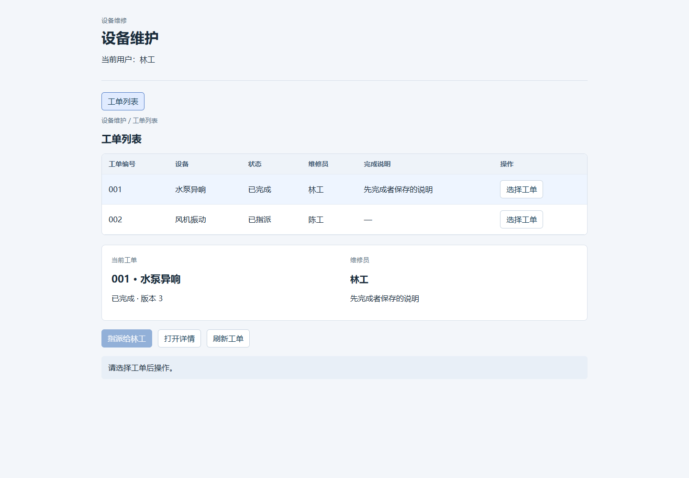
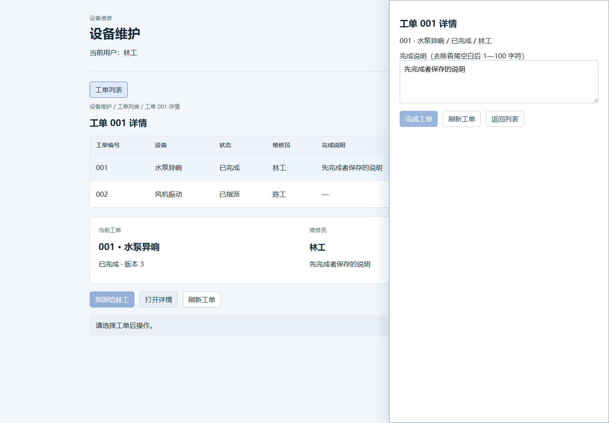

# 设备维修工单 · 需求规格 1.3

这是虚构的教学样例，文中约定仅适用于本例。配套 [纯产品态原型](product-prototype.html) 与 [评审态原型](review-prototype.html) 使用浏览器本地数据模拟业务服务，不连接真实设备、账号或后端。

本次规格 1.3 取代 1.2：把列表按列展示，并将两态业务处理提取为同一实现；角色、状态、输入和验收保持不变。旧运行证据不自动标为新版通过。

本次交接只实现下述指派与完成链，工单始终按工单编号识别，模块一/二的正反用例就是接收标准；不扩展创建、转派等已排除功能，也不实现身份切换、重置、冲突注入或评审工具。两个模块没有待决政策；框架、接口形式及并发控制机制由研发选择，但不能改变模块中已约定的拒绝与写入结果。

纯产品态默认演示调度员；[林工入口](product-prototype.html?actor=lin)和[陈工入口](product-prototype.html?actor=chen)供测试不同登录上下文，页面不提供身份切换按钮。URL 参数只是本地身份夹具，不是生产认证方式。两态共用业务处理逻辑，各自存储模拟数据，加载同目录 ticket-model.js；交付与启动须保留该依赖。评审态保留造数工具。页面动作与验收对应关系见模块一/二及末尾索引，不另建一套规则。

## 目标、范围与阅读入口

调度员把待处理工单指派给维修员；维修员填写结果并完成工单。成功意味着工单状态、执行人、完成说明和审计记录一致。只做这条链，不包括创建、撤销、转派、审批、费用、统计指标或通知。实际项目若需要这些能力，应明确补充，不可凭示例推断。

| 接收角色 | 从哪里读 | 应能直接确定什么 |
|---|---|---|
| 产品经理 | 本节、模块一和模块二 | 范围、业务状态、谁能操作和完成标准 |
| 前端工程师 | 每个模块的页面、反馈和恢复 | 按钮条件、输入保留、成功后的页面变化 |
| 后端工程师 | 共用约束、每个模块的业务结果 | 权限、版本、原子写入和失败无副作用 |
| 测试工程师 | 每个模块的正反用例 | 前置数据、单一失败条件、页面及数据结果 |

## 模块关系与主链

工单列表（定位和指派） → 当前工单详情（填写完成说明） → 原列表显示已完成。
同一个工单编号贯穿全程，打开详情不创建新工单。状态只允许“待处理 → 已指派 → 已完成”；本例不支持其他业务动作。

调度员和维修员均可查看本例固定的两张工单。仅调度员可指派；只有被指派的维修员可完成。评审态的角色切换与产品态 URL 身份参数仅模拟身份，生产身份必须由服务端认证提供。

<!-- ADS:scope -->
## 模块一：定位和指派

**入口与目标。** 导航“工单列表”展示工单编号、设备、状态、维修员和说明。打开详情仅改变当前页面上下文；指派按钮始终针对当前选中的工单，成功结果就地更新。

**页面与流程。** 列表同时展示本例两张工单，按编号升序；点击某行“选择工单”定位后，下方操作针对该工单，不改变业务数据。初始示例：工单 001 是“水泵异响”、待处理、无维修员、版本 1；工单 002 是“风机振动”、已指派给陈工、版本 1。调度员选择工单 001，点击“指派给林工”，确认成功后显示“已指派 / 林工”。本例只有这一名可选指派对象，不代表生产只能有一人。

图：规格 1.3 本地产品原型的实际浏览器截图，展示完成路径后的数据；截图不代替用例执行。

**业务结果。** 仅当调用者为调度员、工单仍待处理且读取版本等于当前版本时，指派成功：在同一原子操作中写入林工身份、状态改为已指派、版本加一，并追加一条含工单、操作者、动作和时间的审计记录。无通知或外部写入。

**拒绝与恢复。** 非调度员不得指派；已指派/已完成工单不得重复指派。旧版本请求必须拒绝，提示“工单已更新，请刷新后重试”，保留当前选择；列表操作区提供“刷新工单”，重新读取当前编号的最新工单并保留选择，不自动重复请求；无需进入详情寻找恢复入口。失败不得更改工单或追加成功审计。原型按钮可用性不能替代业务层校验。

| 用例 | 前置数据与操作 | 页面结果 | 业务结果 |
|---|---|---|---|
| 指派成功 | 重置数据；调度员对版本 1 的工单 001 指派林工 | 已指派、林工 | 版本 2，恰好一条指派审计 |
| 身份拒绝 | 重置数据；仅将身份改为林工，直接请求指派工单 001 | 提示仅调度员可指派 | 工单仍待处理、版本 1、审计 0 条 |
| 重复请求 | 完成第一次合法指派后，以最新版本再次指派 | 提示当前状态不能指派 | 执行人、版本和审计数量不变 |

本模块没有待决政策。实现可以选择自己的框架和接口形式，不能改变上述结果。
<!-- ADS:SECTION scope END -->

<!-- ADS:behavior -->
## 模块二：查看详情与完成工单（业务规则）

**入口与输入。** 点击“打开详情”进入所属工单抽屉，标题与面包屑显示当前工单；返回后仍选中原工单。完成说明为纯文本，去除首尾空白后必填、最长 100 个 Unicode 码点；空白字符串不合格。输入不解释为 HTML。

**正常流程。** 林工打开已指派给自己的工单 001，填写“更换轴承，试运行正常”，点击“完成工单”。成功后抽屉关闭，列表显示已完成，并显示保存的说明。

图：当前工单详情抽屉，已完成工单只读；可编辑条件仍按本模块定义。

**业务结果。** 每次请求按服务端认证身份校验维修员等于工单指派人、当前状态为已指派、读取版本仍匹配及说明有效。全部通过才原子写入完成说明、已完成状态、版本加一和一条完成审计；不能先写说明后校验身份。

**拒绝与恢复。** 未获指派的人、调度员、空白/过长说明、已完成状态或旧版本均不得完成。拒绝后抽屉不关闭，说明保留，提示具体原因；旧版本时允许点击抽屉内“刷新工单”读新版本并保留说明，再由用户重新提交。列表和抽屉复用同一读取动作；刷新后若已完成，则保持说明输入可见但完成按钮不可用，不覆盖已有完成结果。重复点击或重复请求不能产生第二条完成审计。

| 用例 | 前置数据与操作 | 页面结果 | 业务结果 |
|---|---|---|---|
| 完成成功 | 独立重置并合法指派工单 001 给林工；林工填写有效说明后完成 | 抽屉关闭，列表显示已完成和说明 | 同一工单版本 3，累计两条审计 |
| 无权完成 | 重置后以林工打开已指派给陈工的工单 002；填有效说明后直接请求完成 | 提示仅被指派维修员可完成，输入保留 | 工单 002 状态、版本和审计不变 |
| 空值拒绝 | 合法指派后，林工仅填写空格并完成 | 提示填写完成说明，抽屉保留 | 状态仍已指派，不追加审计 |
| 版本冲突 | 合法指派后打开详情并填有效说明；模拟别人更新版本，再完成 | 提示刷新，说明保留 | 旧版本不得覆盖新版本，不追加完成审计 |
| 另一窗口已完成 | 两个林工窗口均打开已指派的 001；窗口 A 先完成，窗口 B 保留另一说明再提交 | B 拒绝，保留输入；刷新显示已完成，完成按钮不可用 | A 的说明和版本不被覆盖，仍只有一条完成审计 |
| 恢复成功 | 承接冲突用例，刷新后再次完成 | 输入仍在，成功返回列表 | 新版本加一且只有一次完成写入 |

本模块没有待决政策；本例“模拟版本更新”只用于构造冲突，不能解释为已经实现生产并发控制。
<!-- ADS:SECTION behavior END -->

<!-- ADS:acceptance -->
## 共用约束与验收边界

刷新后工单、完成说明和审计恢复；本地模拟存储失败须提示，不能宣称已保存。原型中的模拟身份、重置、冲突构造和评审工具，仅用于演示与核对，不是维修业务功能。工具说明见原型的“样例与评审工具说明”。

原型在每次提交前重新读取共享本地存储，按当前记录与本次读取版本判断；刷新也从同一存储重读，不只复制页面内存。双页先后提交只能验证过期快照的拒绝，不能证明 localStorage 具备跨页原子事务。本原型验证交互和本地模拟规则；真实认证、数据库事务、网络失败、多人并发及客户签署均未证明。正式工程须按本节和模块用例实现对应服务端约束后验证。

## 原型与实现的边界

| 原型内容 | 是什么 | 实现时保留或替换什么 |
|---|---|---|
| 工单列表、选择、指派、详情、完成 | 本规格的产品交互 | 保留模块定义的身份、状态、数据结果及恢复；不能把列表改成对象下拉框 |
| 固定两张工单与“指派给林工” | 为本例缩小范围的教学数据与指派对象 | 本例按模块验收；迁移到真实项目时从获准业务规则确定工单与维修员来源，不能默认为永远只有林工，也不凭示例擅增人员管理 |
| ?actor=、模拟身份、重置、冲突注入 | 身份及异常场景夹具 | 不实现为生产认证、业务功能或绕过服务端校验的入口 |
| localStorage 与 ticket-model.js | 本地存储及请求模拟 | 可选择实际技术；必须保留失败不写入、重试不重复以及提交时重新鉴权的业务结果；浏览器模拟不证明真实事务或多人并发 |
| 评审面板与技术追溯 ID | 可选评审辅助 | 不属于工单产品功能；产品交付只需要本文与产品页及其依赖，不以完成评审面板为开工条件 |

本例已经选定只做指派到完成，不做创建、转派等分支，以便独立检验这条业务链；需要这些能力时重新明确业务规则，而非由编码者自行推定。框架、存储实现、接口路径可自定；模块中的拒绝、输入保留与写入结果不可变。这里没有真实项目授权，也没有待决政策被默认实现。

## 需求追溯索引

| 标识 | 定义及适用范围 |
|---|---|
| REQ-REPAIR | 本例维修指派到完成链 |
| SRC-X | 本文虚构教学约定，不是客户授权 |
| ROLE-OPERATOR | 身份分别为调度员、林工、陈工；权限按两个模块 |
| VIEW-X | 工单列表，指派入口与持久结果 |
| DRAWER-X | 当前工单详情及完成输入 |
| ACT-X-NAVIGATE | 返回工单列表，保留当前工单选择，不写业务数据 |
| ACT-X-SUBMIT | 模块一指派给林工，守卫及副作用见模块一 |
| ACT-X-CONFIRM | 模块二完成工单，守卫及副作用见模块二 |
| RULE-READY | 对应模块身份、状态、版本、输入同时满足 |
| RULE-DUPLICATE | 重复指派或完成不得追加成功写入 |
| REG-RESULT | 当前工单状态、维修员和完成说明 |
| STATE-SAVED | 指派或完成成功后对应业务状态，不是需求确认状态 |
| EVT-SAVED | 对应成功操作的一条工单审计记录 |
| AC-X-SUBMIT | 模块一全部正反用例 |
| AC-X-CONFIRM | 模块二全部正反用例 |
<!-- ADS:SECTION acceptance END -->
